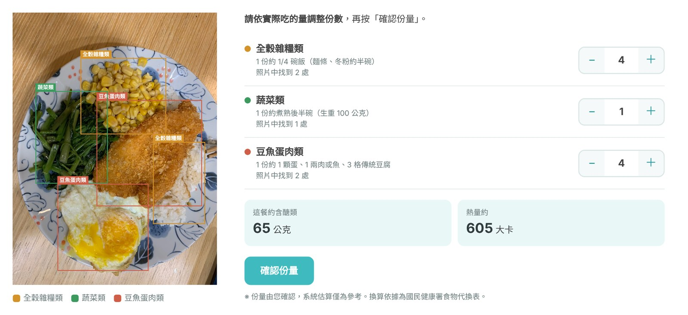
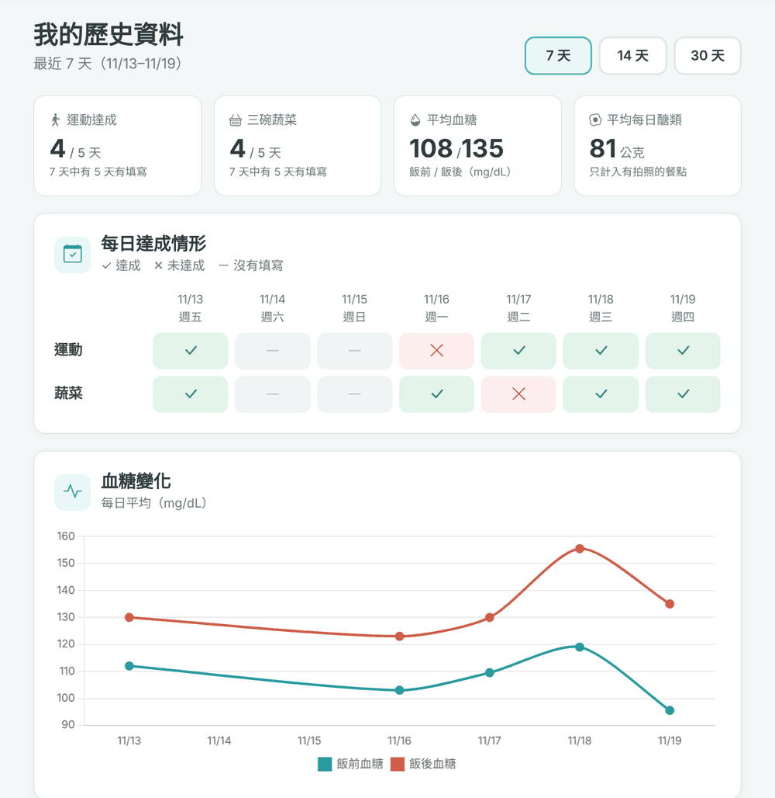
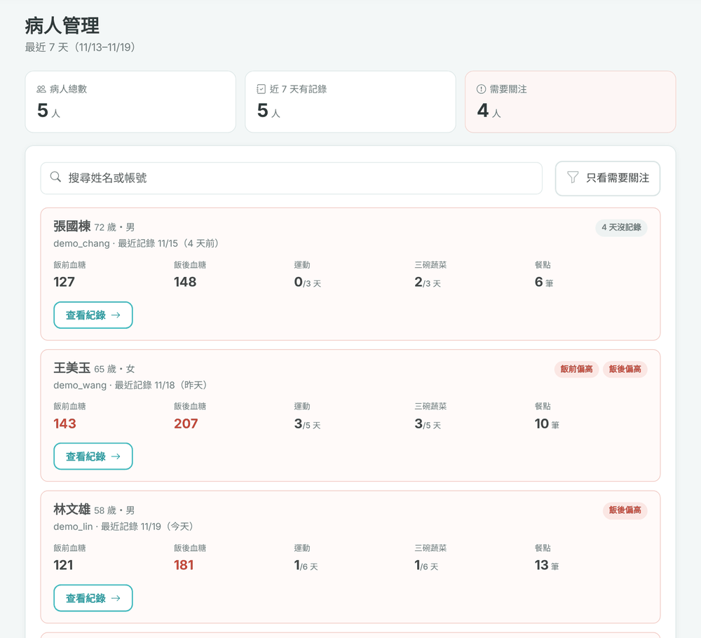
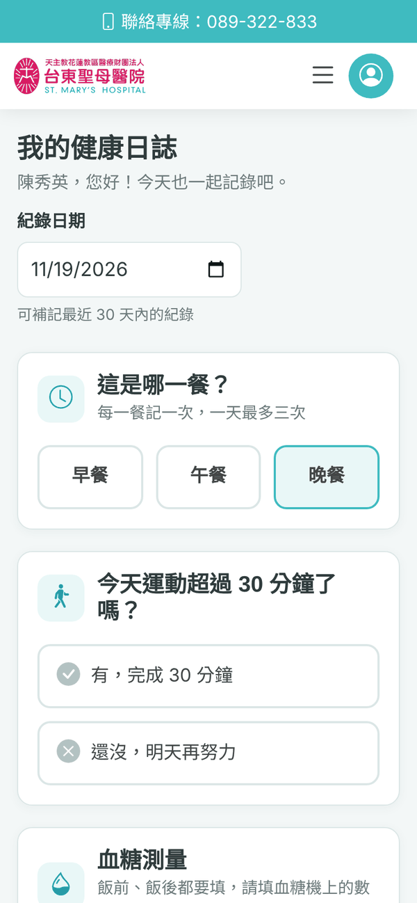

# 應用影像辨識技術實踐智慧健康日誌管理

以 YOLOv9 辨識餐盤中的食物類別，輔助糖尿病病友記錄飲食與血糖。

國立臺東大學資訊管理學系 114 級畢業專題（獨立完成，2023/10–2024/11），與台東聖母醫院國科會計畫「健康促進，科技包容」合作。

> **English summary** — A diet and blood-glucose logging web app for people with diabetes, built independently as my undergraduate capstone in Information Management at National Taitung University, in collaboration with a government-funded (NSTC) health-promotion project at St. Mary's Hospital, Taitung.
> Patients log blood glucose, exercise and a meal photo; a YOLOv9 (GELAN-s) model detects three food groups (grains & starches, vegetables, protein foods), and the patient confirms the servings, which are converted into carbohydrates and calories using Taiwan's food exchange list.
> Clinical staff get a read-only view that flags patients who have stopped logging or whose glucose is outside the target range.
> Built with Flask, SQLite and Chart.js. The original model almost never recognised whole-tray photos (mAP50 0.084 on 30 held-out photos); after fixing two training issues and adding 70 tray photos to training, it reaches 0.661 on the same photos, with the grain and vegetable classes as the next targets for improvement (0.958 on single-dish test images).

年長的糖尿病病友常常因為操作麻煩而無法持續紀錄飲食。本系統讓使用者在記錄血糖、運動的同時，上傳一張餐點照片，由 YOLOv9 模型辨識餐盤中的**全穀雜糧類、蔬菜類、豆魚蛋肉類**，使用者確認份數後換算醣類與熱量，資料存入資料庫後可在歷史頁面查看趨勢。

## 畫面

截圖使用示範資料（見「參考資料」中的示範資料），照片取自未參與訓練的整盤照片。



上傳餐點照片後，框出各類食物，由使用者確認份數並換算醣類與熱量。（介面上照片與份數是上下排列，這張圖為方便閱讀改成左右並排。）

<table>
  <tr>
    <td width="50%" valign="top"><br>歷史資料：可切換 7／14／30 天，查看統計、每日達成情形與血糖變化</td>
    <td width="50%" valign="top"><br>醫護端病人清單：標示久未記錄與血糖超出控制目標的病人</td>
  </tr>
  <tr>
    <td colspan="2" align="center"><br>手機版健康日誌：字級與按鈕放大，以整塊按鈕作答</td>
  </tr>
</table>

## 開發歷程與模型成果

### 整盤照片：mAP50 從 0.084 提升到 0.661

專題展出版本在單一菜色的照片上表現不錯，但病友實際拍的多半是整盤餐點（自助餐餐盤、一盤多道菜），舊模型在這種照片上幾乎辨識不出來。這一版找出了原本訓練的兩個問題（見下一節），並加入整盤照片重新訓練：共 100 張整盤照片，以模型產生的框為初稿、逐張人工檢查校正；其中 70 張加入訓練集，另外 30 張依拍攝梯次分組保留、完全不參與訓練，用來比較加入前後的差異。兩個模型都在同一組 30 張上評估：

| 類別 | 加入整盤資料前 mAP50 | 加入後 mAP50 | 加入前 mAP50-95 | 加入後 mAP50-95 |
|---|---|---|---|---|
| 整體 | 0.084 | **0.661** | 0.032 | **0.422** |
| 全穀雜糧類 | 0.077 | 0.563 | 0.019 | 0.299 |
| 蔬菜類 | 0.085 | 0.570 | 0.038 | 0.272 |
| 豆魚蛋肉類 | 0.091 | 0.850 | 0.040 | 0.695 |

加入後的 Precision / Recall：整體 0.627 / 0.646，全穀雜糧類 0.584 / 0.512，蔬菜類 0.554 / 0.682，豆魚蛋肉類 0.741 / 0.744。

從這組結果可以看到：

- **瓶頸在訓練資料，而不是類別本身難以區分。** 原本的訓練資料幾乎沒有多道菜同時出現的畫面；只補上 70 張整盤照片，同一組測試照片的 mAP50 就從 0.084 提升到 0.661。
- **下一步的方向。** 整盤照片與單一菜色測試集（0.958）仍有差距，其中全穀雜糧類與蔬菜類是優先改善的類別；整盤測試集目前為 30 張，增加標註量後可以得到更穩定的評估（見「限制與未來方向」）。

### 這一版修正了原本訓練的兩個問題

- **驗證集與訓練集重疊**：原本 16 張驗證圖全部也在訓練集中，當時的 mAP 不能代表模型的真實表現。新版以內容雜湊去除重複，並以來源圖片為單位切分。
- **預訓練權重沒有用上**：原本以 `yolov9.yaml`（約 7,000 萬參數）搭配 `yolov9-s` 權重（約 700 萬參數），兩者尺寸不同，1,411 層中只有 15 層能沿用，等於從零訓練。新版改用配對的 `gelan-s.yaml` 與 `gelan-s.pt`，1,339 層中 1,333 層成功沿用（只有輸出層因類別數不同而重新訓練）。

### 模型設定


| 項目 | 內容 |
|---|---|
| 架構 | GELAN-s（YOLOv9 系列，約 720 萬參數），以官方 `gelan-s.pt` 預訓練權重微調 |
| 類別 | 全穀雜糧類、蔬菜類、豆魚蛋肉類（分類規則見 `training/LABELING.md`） |
| 資料 | 原 8 類菜色資料 + Chinese Cafeteria 資料集，轉換為三類後共 1,354 張，再加入 100 張整盤照片（以模型產生的框為初稿、逐張人工校正）；以來源圖片分組、分層切分為 train 1,015 / val 202 / test_single 207 / test_tray_holdout 30 張 |
| 訓練 | Google Colab T4 GPU，100 epochs，輸入 640 px，batch size 32，約 1.25 小時 |
| 推論 | 伺服器啟動時載入一次；T4 上每張約 9 ms |

### 單一菜色測試結果（test_single，207 張，未參與訓練與模型選擇）

| 類別 | Precision | Recall | mAP50 | mAP50-95 |
|---|---|---|---|---|
| 整體 | 0.910 | 0.916 | 0.958 | 0.823 |
| 全穀雜糧類 | 0.949 | 0.846 | 0.973 | 0.919 |
| 蔬菜類 | 0.945 | 0.949 | 0.976 | 0.788 |
| 豆魚蛋肉類 | 0.836 | 0.953 | 0.924 | 0.761 |

這組測試集以單一菜色的特寫為主；整盤照片的評估結果見上方「整盤照片：mAP50 從 0.084 提升到 0.661」。

## 設計考量

**份數由使用者確認，系統提供預設值。** 模型辨識照片中有哪幾類食物，並依類別帶入預設份數，使用者再以加減按鈕依實際吃的量調整。這樣設計是因為照片拍到的量不一定等於實際吃下的量（例如沒吃完、後來又添飯），由使用者確認，醣類換算才會貼近實際攝取；也讓病友在記錄時順便留意自己每一類吃了多少。

**血糖標色採用糖尿病的控制目標。** 餐前 80–130、餐後 80–160 mg/dL，取自中華民國糖尿病學會的照護指引。系統的使用者是已確診的病友，以控制目標作為參考範圍，醫護人員在病人清單上就能快速找出血糖需要留意的病人。這組數值用於介面標色，供醫護判讀時參考。

**運動與蔬菜的達成率，以有填寫的天數計算。** 例如 7 天中填了 5 天、其中 4 天有運動，就顯示 4 / 5 天。這樣達成率反映的是病友實際做到的程度；至於多久沒有記錄，則由醫護端的「需要關注」標記另外提醒。

## 功能

- 帳號註冊、登入、登出（密碼以雜湊儲存，使用 session 驗證）；註冊時填寫生日與性別，供醫護端判讀紀錄時參考
- 健康日誌：每一筆屬於早餐、午餐或晚餐其中一餐（有沒有拍照都要選），同一天每一餐只有一筆，所以一天最多三筆；記錄運動是否達 30 分鐘、飯前／飯後血糖、三碗蔬菜自評，餐點照片可不拍。四個欄位一律必填，前後端都檢查，避免留下醫護端無法判讀的半筆紀錄；可補記最近 30 天內的紀錄，不能記錄未來的日期
- 食物類別辨識：依國健署每日飲食指南辨識三類食物，在照片上框出辨識結果；使用者以加減按鈕調整份數後，依食物代換表換算醣類與熱量
- 歷史資料：可切換 7／14／30 天，顯示統計（運動與蔬菜達成天數、平均血糖、平均每日醣類）、每日達成情形、血糖折線圖、醣類長條圖，以及這段期間的每一筆紀錄；數字打錯可以修改，也可以刪除整筆紀錄
- 介面以年長使用者為對象：字級與按鈕放大，是／否以整塊按鈕點選，手機與電腦皆可使用
- 醫護端（唯讀）：病人清單顯示年齡與性別，並標示久未記錄與血糖超出參考範圍者，可逐一查看該病人的血糖趨勢、每日達成情形與餐點照片

## 系統架構

```
瀏覽器 (frontend/)  ──HTTP/JSON──▶  Flask (backend/app.py) ──▶ SQLite
                                         │
                                         └──▶ FoodDetector (backend/detector.py)
                                               YOLOv9，伺服器啟動時載入一次
```

| 路徑 | 說明 |
|---|---|
| `backend/app.py` | Flask 後端：帳號、健康日誌、歷史統計、醫護端 API，並提供前端網頁 |
| `backend/detector.py` | 載入 YOLOv9 模型、偵測食物類別並整理為各類份數 |
| `backend/nutrition.py` | 依食物代換表換算醣類與熱量（不相依 PyTorch，便於單獨測試） |
| `backend/food_info.json` | 三類食物的每份營養素、份量說明與預設份數 |
| `backend/manage.py` | 命令列工具：列出帳號、建立醫護帳號、變更角色、重設密碼 |
| `backend/seed_demo.py` | 產生示範病人資料（見「參考資料」中的示範資料） |
| `backend/check_data.py` | 檢查資料是否完整、一致 |
| `backend/schema.sql` | 資料表結構 |
| `backend/yolov9/` | YOLOv9 官方原始碼（僅保留推論與訓練所需部分） |
| `frontend/` | 網頁介面（以 Medicio 模板修改）；`staff*.html` 為醫護端；`assets/js/history-view.js` 為病人與醫護端共用的統計與圖表 |
| `training/` | 資料集設定與訓練紀錄；`results_v1_8classes/` 是專題展出版本（8 類菜色）的訓練結果，僅留作對照 |

## 執行方式

```bash
cd backend
python3 -m venv venv && source venv/bin/activate
pip install -r requirements.txt
# 將模型權重放到 weights/foodgroups_gelan_s.pt（見下方「模型權重」）
python app.py
```

開啟 http://127.0.0.1:5000 ，先註冊帳號再登入。沒有放權重檔時，系統仍可正常執行，只是照片辨識功能會停用。可用的環境變數見下方「參考資料」。

伺服器只接受本機連線（127.0.0.1）。這是 Flask 內建的開發用伺服器，正式部署應改用 gunicorn 等 WSGI 伺服器並加上 HTTPS。

### 模型權重

權重檔 `foodgroups_gelan_s.pt`（約 15 MB）不放在 git 裡，附在本專案 GitHub 的 Releases 頁面；下載後放到 `weights/` 資料夾，或用環境變數 `SHD_WEIGHTS` 指定其他位置。

## 角色與權限

帳號分為「病人」與「醫護人員」兩種角色，記錄在 `users.role`。

- 從註冊頁註冊的帳號一律是病人，**無法自行成為醫護**，避免任何人註冊後就能看到所有病人的資料。
- 醫護帳號由系統管理者在伺服器上建立：

```bash
python backend/manage.py create-staff nurse --name "王護理師"   # 會詢問密碼
python backend/manage.py list                                   # 列出所有帳號與角色
python backend/manage.py set-role <帳號> staff                  # 將既有帳號改為醫護
python backend/manage.py set-password <帳號>                    # 重設密碼
```

- 登入後會依角色導向：病人到健康日誌，醫護到病人清單；開到不屬於自己角色的頁面會被導回。
- 醫護端一律唯讀，不能代替病人新增或修改紀錄；醫護帳號也不能記錄自己的健康日誌。
- 餐點照片不是公開路徑，必須經過 `/api/photos/<檔名>` 並通過身分檢查才取得。

## 參考資料

<details>
<summary>環境變數</summary>

可用的環境變數：`SECRET_KEY`（正式部署時必填；沒設定時每次啟動隨機產生，重啟後所有人都要重新登入）、`SHD_WEIGHTS`、`SHD_DB`、`SHD_UPLOADS`（餐點照片存放位置）、`SHD_DEVICE`（`cpu` 或 `0` 代表第一張 GPU）、`SHD_IMGSZ`、`PORT`（預設 5000）、`FLASK_DEBUG=1`（開發時顯示錯誤細節）。

</details>

<details>
<summary>API</summary>

| 方法 | 路徑 | 說明 |
|---|---|---|
| POST | `/api/register` | 註冊（username、password、birthday、gender，display_name 選填） |
| POST | `/api/login` / `/api/logout` | 登入／登出 |
| GET | `/api/me` | 目前登入者資訊 |
| POST | `/api/logs` | 新增日誌（multipart，必填 `meal_type`，可附 `photo`），回傳辨識結果、各類別預設份數與醣類；同一天同一餐已有紀錄時回 409，帶 `replace=1` 會整筆取代。資料庫以 (user_id, log_date, meal_type) 唯一索引確保一餐只有一筆 |
| PATCH | `/api/logs/<id>` | 修改一筆日誌的運動、血糖、蔬菜 |
| PUT | `/api/logs/<id>/servings` | 使用者確認或修改各類別份數，重新換算醣類與熱量 |
| DELETE | `/api/logs/<id>` | 刪除一整筆日誌（含照片） |
| GET | `/api/history?days=7` | 逐日血糖平均、每日醣類、運動與蔬菜達成情形，以及區間內的每一筆紀錄 |
| GET | `/api/photos/<檔名>` | 餐點照片；僅上傳者本人或醫護帳號可取用 |
| GET | `/api/staff/patients?days=7` | 醫護端：病人清單與近 n 天摘要 |
| GET | `/api/staff/patients/<id>?days=14` | 醫護端：單一病人的統計、達成情形與餐點（含辨識框） |

</details>

<details>
<summary>示範資料</summary>

為了讓醫護端的畫面有足夠的病人可看，`backend/seed_demo.py` 會建立一批 `demo_` 開頭的示範帳號：

```bash
python backend/seed_demo.py            # 新增示範病人（已存在就略過）
python backend/seed_demo.py --reset    # 先清掉舊的示範資料再重建
```

`backend/check_data.py` 用來檢查資料是否完整，例如每筆紀錄的欄位都有值、照片與辨識結果對得上：

```bash
python backend/check_data.py                      # 檢查
python backend/seed_demo.py --backfill <帳號>      # 補齊舊紀錄缺的欄位
```

- **病人與數值：** 姓名為虛構，血糖為隨機產生，並刻意讓部分病人出現「飯前偏高」「飯後偏高」「飯前偏低」「久未記錄」等狀況，方便展示醫護端的標記。
- **餐點照片：** 使用自己拍攝、未參與訓練的餐盤照片，辨識框是模型實際辨識的結果。照片不在 git 裡，所以 clone 下來的環境中，示範紀錄不會有照片。
- **登入：** 示範帳號的密碼是隨機產生的，需要登入時用 `manage.py set-password` 設定。

</details>

<details>
<summary>統計的定義與血糖參考範圍</summary>

- **運動、三碗蔬菜的達成率**：分母是區間內「有填寫的天數」，沒有記錄的日子不算成未達成（例如 7 天中填了 5 天、其中 4 天有運動，顯示 4 / 5 天）。病人自己的頁面、醫護清單與醫護的病人頁都用這個定義，同一段期間看到的數字一致。
- **平均每日醣類**：只計入有拍照記錄的餐點，沒拍照的餐不在內，所以只拍一餐的日子會偏低。
- **近 7 天有記錄**：區間內至少有一天紀錄。

病人清單上的「需要關注」標記，依據是 `backend/app.py` 裡的兩個設定：超過 `INACTIVE_DAYS`（預設 3 天）沒有任何紀錄，或平均血糖超出 `GLUCOSE_REF`。

預設值採用中華民國糖尿病學會《糖尿病臨床照護指引》的成人糖尿病控制目標：餐前 80–130 mg/dL、餐後 1–2 小時 80–160 mg/dL。系統的使用者是已確診的病友，因此以「控制目標」而非健康成人的診斷正常值（空腹 70–99、飯後兩小時低於 140）作為參考，標記能更準確地反映每位病人的控制情形。

這組數值用於介面標色，協助醫護人員快速判讀，臨床判斷仍以醫療團隊為準。血糖目標會依年齡、共病與低血糖風險個別調整（例如 65 歲以上長者通常放寬），未來可以擴充為由醫護人員替每位病人設定個人化的目標範圍。

</details>

<details>
<summary>重新訓練模型</summary>

```bash
# 1. 產生三類資料集（需要原始資料，見 training/prepare_foodgroups.py 說明）
python training/prepare_foodgroups.py --own <原本資料集>/train --cc <Chinese Cafeteria>/data --out training/foodgroups

# 2. 建立訓練環境
python3 -m venv venv && source venv/bin/activate
pip install -r backend/requirements-train.txt

# 3a. 在 Google Colab 上訓練（建議）：執行 training/pack_for_colab.sh，再開啟 training/colab_train.ipynb
# 3b. 或在 Apple Silicon Mac 上訓練；8 GB 記憶體的機器請用 BATCH=4（100 epochs 約 10 小時）
BATCH=4 bash training/train_mac.sh full

# 4. 評估（單一菜色測試集；整盤測試集補標完成後也會一起評估）
bash training/evaluate.sh <best.pt 的路徑> mps

# 4b. 在整盤測試集上評估（training/foodgroups/tray_eval.yaml）
python backend/yolov9/val.py --weights <best.pt 的路徑> --data training/foodgroups/tray_eval.yaml --task test --imgsz 640 --device mps
```

</details>

## 限制與未來方向

1. **整盤照片的辨識**：加入 70 張整盤照片訓練後，整盤測試集的 mAP50 從 0.084 提升到 0.661；與單一菜色的 0.958 相比仍有提升空間，全穀雜糧類（0.563）與蔬菜類（0.570）是優先改善的類別。整盤照片的食物彼此緊鄰、互相遮擋，白飯也常被菜餚蓋住，下一步會持續增加整盤照片的標註量。
2. **全穀雜糧類的偵測率**：召回率在單一菜色測試集為 0.85、整盤測試集為 0.51。全穀雜糧是醣類的主要來源，提高這一類的偵測率能讓醣類估算更準確，是下一步的重點。
3. **份量估算**：目前由模型判斷有哪幾類食物，系統依類別帶入預設份數，並自動合併同一處食物上重複的偵測框，再由使用者依實際食量確認。未來規劃以分割模型計算食物面積，並以碗、盤或便當盒邊緣作為比例尺，從照片直接估算份量。
4. **醣類換算**：依國健署食物代換表，每份全穀雜糧類以 15 g 醣類、蔬菜類以 5 g 醣類計，碗數換算以白飯為準；混合菜依主要成分歸類。未來可以針對麵食、混合菜細分換算方式。
5. **三碗蔬菜**：目前由使用者自評，未來可結合影像辨識的蔬菜份數輔助判斷。
6. **醫護端功能**：目前提供唯讀的病人清單與個別紀錄。下一步可加入衛教備註、匯出報表，以及依年齡與共病替每位病人設定個人化的血糖目標。
7. **帳號管理**：目前由管理者以 `manage.py set-password` 重設密碼。未來可加入線上重設密碼、病人自行修改密碼與基本資料、登入失敗次數限制，以及在歷史頁查看自己的餐點照片。

## 第三方程式碼與授權

- [YOLOv9](https://github.com/WongKinYiu/yolov9)（`backend/yolov9/`），GPL-3.0，授權條款見 `backend/yolov9/LICENSE.md`。為相容較新版的 PyTorch、Pillow 與 NumPy，做了以下最小修改：載入權重時指定 `weights_only=False`（`train.py`、`models/experimental.py`、`utils/general.py`、`utils/loggers/__init__.py`）；Apple GPU 偵測改用 `torch.backends.mps.is_available()`（`utils/torch_utils.py`）；以 `getbbox` 取代已移除的 `getsize`（`utils/plots.py`）；`np.trapz` 改用 `np.trapezoid`（`utils/metrics.py`）；`np.float` 改為 `float`（`models/common.py`）。
- [Medicio](https://bootstrapmade.com/medicio-free-bootstrap-theme/) 網頁模板，BootstrapMade。修正了 `assets/js/main.js` 在沒有「回到頂端」按鈕的頁面會報錯的問題。
- [Chart.js](https://www.chartjs.org/)，MIT（`frontend/assets/vendor/chartjs/`）。

由於包含 GPL-3.0 的 YOLOv9 程式碼，本專案整體以 GPL-3.0 釋出。
